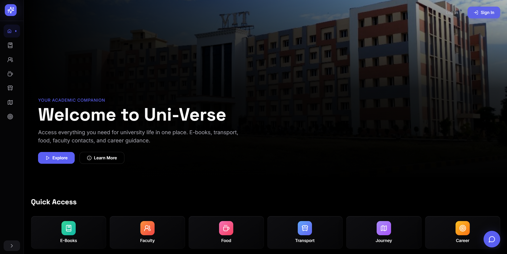
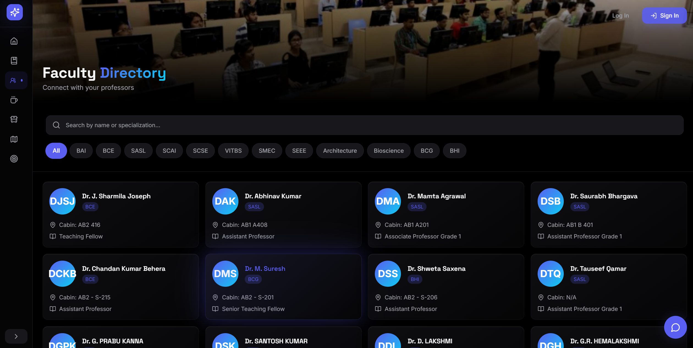

<div align="center">
  

  <br />
  <br />

  # 🎓 Uni-Verse
  **Your Academic Super-App. Reimagining the University Experience.**

  <p align="center">
    <a href="https://uni-verse-swart.vercel.app/">
      
    </a>
    <a href="https://github.com/m4n1kya/Uni-Verse/actions">
      
    </a>
    
    
    
    <a href="./LICENSE">
      
    </a>
  </p>
</div>

---

## 🚀 Overview

**Uni-Verse** unifies fragmented university portals into a single, ultra-fast, pitch-black glassmorphic workspace. Instead of switching between disconnected apps for bus schedules, digital library notes, faculty directories, cafeteria menus, and placement statistics, students get every essential campus service in one cohesive interface.

👉 **Live Production App:** **[uni-verse-swart.vercel.app](https://uni-verse-swart.vercel.app/)**

---

## ✨ Key Modules



| Module | Capabilities |
| :--- | :--- |
| 📚 **E-Books & Academic Hub** | Browse and download curated course PDFs, lecture slides, and question banks organized by subject and unit. |
| 🧑‍🏫 **Faculty Directory** | Search professors by department, specialization, cabin location, and consultation hours. |
| 🍔 **Campus Food Court** | Explore campus dining vendors, live menus, vegetarian/non-vegetarian filters, and popular specials. |
| 🚌 **Transport Hub** | Track campus shuttle routes, departure schedules, and cab pooling options in real time. |
| 🎓 **Student Journey** | Visualize your 4-year B.Tech roadmap, semester milestones, and academic progression. |
| 💼 **Career Hub** | Filter 40+ recruiting companies by GPA cutoff, CTC packages, required DSA topics, and curated prep links. |

---

## 🏗️ Project Structure

```text
Uni-Verse/
├── .github/                 # CI workflows, issue templates & contribution guides
├── docs/                    # System architecture, API specs & preview screenshots
├── public/                  # Static assets & downloadable course PDFs
├── src/
│   ├── assets/              # Optimized module & vendor imagery
│   ├── components/
│   │   ├── layout/          # Sidebar, BottomNav & MainLayout shell
│   │   └── ui/              # Accessible Radix UI + Tailwind primitives
│   ├── data/                # Structured datasets for courses, faculty & companies
│   ├── hooks/               # Custom React hooks (responsive viewport, toasts)
│   ├── lib/                 # Classname merging & shared utilities
│   ├── pages/               # Route-level views (Index, Career, Faculty, FoodCourt, etc.)
│   ├── App.tsx              # Application router & provider hierarchy
│   └── main.tsx             # DOM entrypoint
├── index.html               # HTML root template
├── tailwind.config.ts       # Custom design tokens, animations & color palette
├── tsconfig.json            # TypeScript compiler configuration
└── vite.config.ts           # Vite bundler & path alias setup
```

---

## 🛠️ Tech Stack

| Layer | Technology |
| :--- | :--- |
| **Framework** | React 18 + TypeScript 5 |
| **Build Tool** | Vite 5 (SWC Compiler) |
| **Styling** | Tailwind CSS + CSS Custom Properties |
| **UI Primitives** | Radix UI + shadcn/ui |
| **Iconography** | Lucide React |
| **Routing & State** | React Router v6 + TanStack Query |
| **Deployment** | Vercel Edge Network |

---

## ⚡ Quick Start

### Prerequisites
- **Node.js** `>= 18.0.0`
- **npm** `>= 9.0.0`

### Installation & Local Development

```bash
# 1. Clone the repository
git clone https://github.com/m4n1kya/Uni-Verse.git

# 2. Navigate into the project directory
cd Uni-Verse

# 3. Install dependencies
npm install

# 4. Start the Vite development server
npm run dev
```

Open **[http://localhost:8080](http://localhost:8080)** (or `http://localhost:5173`) in your browser.

### Production Build

```bash
npm run build
npm run preview
```

---

## 📄 Documentation

Detailed architectural specifications, REST API contracts, database schemas, and security policies are available in the **[`docs/`](./docs/README.md)** directory.

---

## 👨‍💻 Author & License

Designed and engineered by **Manikya N** ([@m4n1kya](https://github.com/m4n1kya)).  
Released under the **[MIT License](./LICENSE)**.
