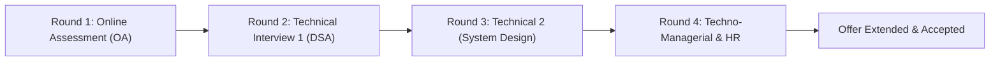
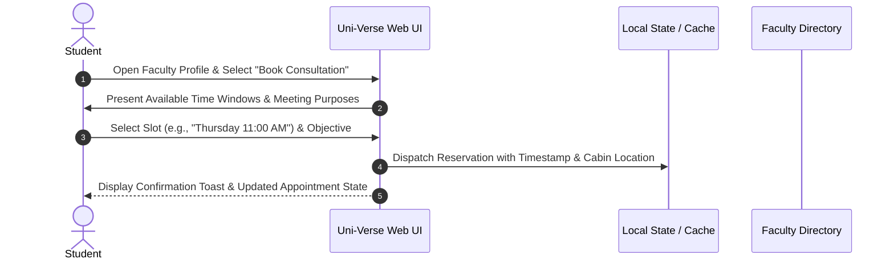

# Architecture Specification: Student Lifecycle & Placement Intelligence Engine (v2.4)

**Status:** Ratified  
**Author:** Uni-Verse Academic & Placement Engineering Core  
**Domain:** Undergraduate Milestones, Recruitment Matching & Faculty Consultation  
**Target Runtimes:** Web Client (React 18 / Vite 5), Edge API (Cloudflare Workers), Student Information System (SIS)

---

## 1. Executive Summary

The **Student Lifecycle & Placement Intelligence Engine** unifies four-year undergraduate degree progression with real-time enterprise recruitment matching and faculty mentorship scheduling. As students progress across curricular stages (Foundation, Core Development, Specialization, Capstone), the engine dynamically evaluates placement eligibility, tracks curricular completion percentages, and coordinates 1-on-1 faculty consultations.

This specification details the mathematical models, data schemas, and lifecycle workflows implemented across `Journey.tsx`, `Career.tsx`, and `Faculty.tsx`.

---

## 2. Degree Completion & Graduation Readiness Computation

### 2.1 Progress Aggregation Model

Degree readiness ($R$) is computed as a weighted normalized summation of curricular coursework ($C$) and accredited external/NPTEL certifications ($A$):

$$R = \frac{\sum_{i=1}^{Y} \left( w_c \cdot |C_i^{\text{done}}| + w_a \cdot |A_i^{\text{done}}| \right)}{\sum_{i=1}^{Y} \left( w_c \cdot |C_i^{\text{total}}| + w_a \cdot |A_i^{\text{total}}| \right)} \times 100\%$$

Where:
- $Y = 4$ (undergraduate academic years).
- $w_c = 1.0$ (weight coefficient for core academic courses).
- $w_a = 0.5$ (weight coefficient for industry certifications).
- $R \in [0, 100]\%$, rendered with $0.00\text{ CLS}$ via responsive CSS transition tracks in `Journey.tsx`.

### 2.2 Milestone Persistence Protocol

Individual course checkboxes and certification completions are persisted client-side in `localStorage` under namespaced key `universe_completed_milestones` with optimistic hydration fallback.

---

## 3. Placement Eligibility & Shortlisting System

### 3.1 Eligibility Predicate Matching

Enterprise recruiting partners enforce multi-variable admission thresholds. A student profile $S = \langle \text{CGPA}, \text{Skills}, \text{DSA} \rangle$ is classified into qualifying tiers:

$$\text{Eligible}(S, E) \iff \text{CGPA}(S) \ge \text{Cutoff}(E)$$

$$\text{Tier}(E) = \begin{cases}
\text{Super Dream} & \text{if } \text{CTC}_{\max}(E) \ge 20\text{ LPA} \\
\text{Dream} & \text{if } 10\text{ LPA} \le \text{CTC}_{\max}(E) < 20\text{ LPA} \\
\text{Regular} & \text{otherwise}
\end{cases}$$

### 3.2 Multi-Stage Interview Telemetry

Company detail modals render standardized 4-stage evaluation timelines:

---

## 4. Faculty Consultation Scheduling Runtime

### 4.1 Consultation Booking Lifecycle

### 4.2 Data Protection & Privacy Standards

- Direct mailto links and 1-click clipboard triggers use institutional email addresses only (`@vitbhopal.ac.in`).
- Personal mobile numbers are never displayed in client bundles; cabin locations reference verified academic blocks (AB1, AB2).
