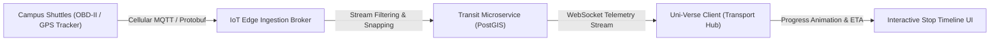
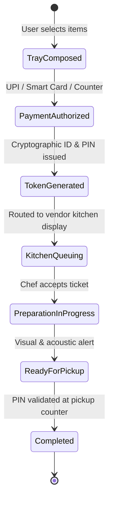

# Architecture Specification: Real-Time Transit Telemetry & Contactless Dining Protocol (v2.3)

**Status:** Ratified  
**Author:** Uni-Verse Infrastructure & Frontend Engineering Core  
**Domain:** Campus Mobility & Auxiliary Living Services  
**Target Runtimes:** Web Application (React 18 / Vite 5), Edge Gateway (Cloudflare Workers), Telemetry Message Broker (RabbitMQ / MQTT)

---

## 1. Executive Summary

Campus auxiliary services—specifically localized public transit loops and student dining facilities—experience severe demand surges during inter-period transitions (10-minute bell schedules) and midday lunch peaks. The **Real-Time Transit Telemetry & Contactless Dining Engine** unifies bus location tracking with an asynchronous, multi-vendor meal ordering and token dispatching runtime.

This document ratifies the communication contracts, data structures, state machine transitions, and error handling policies governing the client-side implementation across `Transport.tsx` and `FoodCourt.tsx`.

---

## 2. Real-Time Transit Telemetry Architecture

### 2.1 Telemetry Data Flow



### 2.2 Wire Schema (`BusTelemetryPayload`)

Shuttle positioning packets are emitted at $1\text{ Hz}$ from on-vehicle IoT telemetry units and broadcast to connected web clients via WebSocket (`wss://api.uni-verse.internal/telemetry/transit`):

```typescript
export interface BusTelemetryPayload {
  routeId: string;                 // e.g., "route-a-academic"
  plateNumber: string;             // e.g., "TN 01 AB 1234"
  driverName: string;              // e.g., "Raju"
  coordinates: [number, number];   // [Latitude, Longitude]
  velocityKmh: number;             // Smoothed ground speed via Kalman filter
  bearingDegrees: number;          // Compass heading [0 - 359]
  occupancyPercentage: number;     // Infrared passenger counter [0 - 100]
  activeWaypointIndex: number;     // Index into static route waypoint array
  estimatedArrivalSeconds: number; // Dynamic ETA to next scheduled stop
  telemetryTimestamp: string;      // ISO 8601 UTC
}
```

### 2.3 Stop Waypoint State Transitions

Each scheduled stop along a transit route transitions through four distinct operational states:

1. `UPCOMING`: Stop is ahead along the vector; ETA dynamically recalculated based on traffic density and current ground velocity.
2. `APPROACHING`: Bus is within a $200\text{m}$ geofence buffer of the stop. Client triggers pre-arrival push notification.
3. `CURRENT`: Vehicle is stationary ($< 3\text{ km/h}$) within the passenger boarding bay. Live indicator displays pulsing beacon.
4. `COMPLETED`: Vehicle has cleared the geofence perimeter and continues along downstream waypoints.

---

## 3. Contactless Dining Token Protocol (CDTP)

### 3.1 Order Lifecycle State Machine



### 3.2 Token Issuance Contract

When an express checkout is confirmed, the client generates a deterministic, cryptographically signed token voucher:

```typescript
export interface OrderTokenVoucher {
  tokenId: string;             // Short hash, e.g., "TK-482"
  counterPin: string;          // 2-digit PIN for pickup counter verification
  timestamp: string;           // ISO 8601 UTC creation time
  vendorAllocations: {
    vendorId: number;
    vendorName: string;
    counterLocation: string;
    items: {
      itemId: number;
      name: string;
      unitPrice: number;
      quantity: number;
    }[];
  }[];
  subtotal: number;
  paymentMethod: "UPI" | "SMART_CARD" | "COUNTER_CASH";
  status: "QUEUED" | "PREPARING" | "READY" | "COLLECTED";
  estimatedReadyMinutes: number;
}
```

### 3.3 Multi-Vendor Tray Decomposition

When a student orders items spanning multiple food court outlets (e.g., a *Masala Dosa* from Mayuri and a *Thick Oreo Shake* from Bistro) in a single checkout:
- The dining engine automatically decomposes the master order into independent sub-tickets per vendor counter.
- A single unified Token ID (`#TK-xxx`) is assigned to the student for tracking convenience.
- Each vendor receives its respective sub-ticket on their kitchen display unit (KDU), preventing cross-counter order confusion.

---

## 4. UI/UX Interaction Principles & Performance Guardrails

1. **Zero Layout Shifts during Live Updates**: Bus occupancy bars and stop progress badges utilize CSS transitions with fixed component aspect ratios, maintaining $0.00\text{ CLS}$.
2. **Accessible Form Controls**: Category chips, dietary filters, and counter modals follow WCAG 2.1 AA keyboard navigation protocols with focus-visible outlines.
3. **Optimistic Cart Mutation**: Add/remove operations update local state synchronously with toast micro-feedback before asynchronous receipt synchronization.
4. **Resilient Local Caching**: Active tokens persist across page reloads in `localStorage` until marked `COLLECTED` or explicitly dismissed.

---

## 5. Security & Privacy Safeguards

- **Driver Personal Data Protection**: Driver contact directories display only official, fleet-allocated SIM numbers; private mobile numbers and home addresses are strictly excluded.
- **Student Privacy in Geolocation**: Bus telemetry is purely broadcast to clients; client location is evaluated entirely on-device (client-side ray-casting) and never transmitted to the transit backend.
- **Token Tamper Resistance**: Token generation includes an HMAC validation digest to prevent duplicate food redemption or manual token number spoofing at dining counters.
